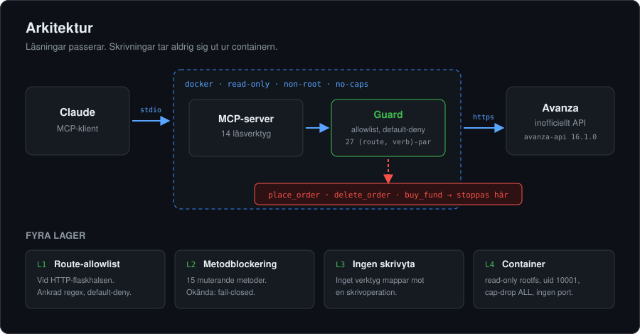
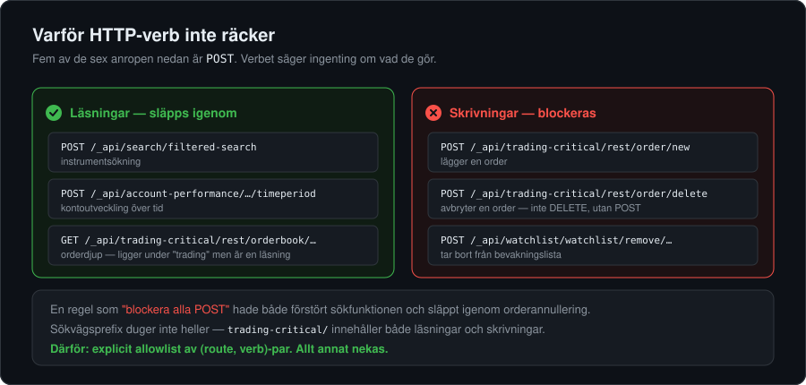
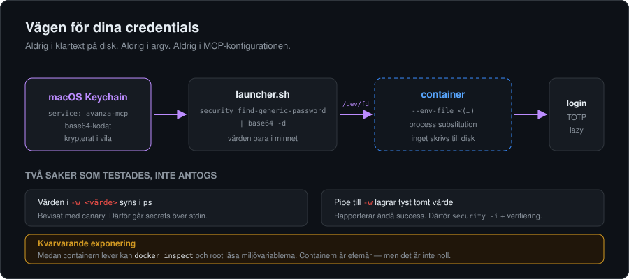

<div align="center">

# Avanza MCP

**Läsåtkomst till ditt Avanza-konto för Claude — utan att någonsin kunna handla.**

[](#hur-read-only-garanteras)
[](#verifierat-inte-antaget)
[](#säkerhetsgranskning)
[](#docker)
[](pyproject.toml)
[](#säkerhet-kring-credentials)

Portfölj · innehav · transaktioner · kursdata · orderbok · nyheter · bevakningslistor

</div>

---

Servern ger Claude 14 läsverktyg mot Avanza. Den **kan inte köpa eller sälja** — och
det är inte en inställning som går att slå av, utan en egenskap som upprätthålls i
fyra oberoende lager, verifieras av 168 tester och har överlevt en oberoende
[adversariell granskning](#säkerhetsgranskning).

<div align="center">
  
</div>

---

## Snabbstart

```bash
./scripts/setup-credentials.sh          # lägger credentials i Keychain (en gång)
docker build -t avanza-mcp:latest .
```

Registrera sedan servern hos din MCP-klient. **Konfigurationen innehåller inga secrets:**

```json
{
  "mcpServers": {
    "avanza": {
      "command": "/absolut/sökväg/till/Avanza MCP/scripts/avanza-mcp-launcher.sh"
    }
  }
}
```

Du behöver ditt TOTP-secret från Avanza: *Min ekonomi → Inställningar → Säkerhet →
Tvåfaktorsinloggning → "Annan app för tvåfaktorsinloggning"*. Det är den långa
strängen — inte den sexsiffriga koden.

---

## Hur read-only garanteras

### Varför det inte räcker att blockera POST

Det uppenbara greppet är "släpp bara igenom GET". Det fungerar inte mot Avanzas API,
för verbet säger ingenting om vad anropet gör:

<div align="center">
  
</div>

Att blockera POST hade alltså **både** förstört sökfunktionen **och** släppt igenom
orderannullering. Sökvägsprefix duger inte heller: `trading-critical/` innehåller
både orderläggning och orderboksläsning.

Därför är skyddet en **explicit allowlist av `(route, verb)`-par** — 27 stycken, med
default-deny på allt annat.

### De fyra lagren

| | Lager | Vad det gör |
|---|---|---|
| **L1** | Route-allowlist | All trafik efter inloggning passerar en enda funktion, `Avanza.__call`. Den wrappas och matchar varje anrop med ankrad regex (`re.fullmatch`). Placeholders matchas med `[^/]*` så ett preparerat id inte kan vandra vidare i sökvägen. |
| **L2** | Metodblockering | De 15 muterande metoderna på klientobjektet ersätts med funktioner som kastar direkt. **Fail-closed på okända metoder** — uppgraderas biblioteket och lägger till något vi inte granskat blockeras det automatiskt. |
| **L3** | Ingen skrivyta | Inget av de 14 verktygen mappar mot en skrivoperation. Alla annoterade `readOnlyHint: true`, `destructiveHint: false`. |
| **L4** | Container | `--read-only` rootfs, `--cap-drop ALL`, `--security-opt no-new-privileges`, non-root (uid 10001), tmpfs för `/tmp`, ingen exponerad port. |

### Verifierat, inte antaget

`tests/test_guard.py` asserterar bland annat att:

- varje skrivroute avvisas — med sitt faktiska verb **och** med alla fyra verb
- **ingen läsroutes regex matchar någon skrivroutes sökväg** (korsprodukt över alla par)
- `PRICE_ALERT_PATH` släpps för GET men avvisas för POST och DELETE
- `/_api/watchlist/watchlist` tillåts medan `.../remove/1/2` avvisas
- varje publik metod i biblioteket är klassificerad som läsning eller skrivning

Utöver testsviten kördes en adversariell kontroll **inne i den byggda imagen**: sju
direkta trading-anrop och fem försök att kringgå metodlagret och gå rakt på HTTP-nivån
(inklusive path traversal). Alla blockerades; läsningar gick igenom.

Kör den själv:

```bash
docker run --rm -i --entrypoint python avanza-mcp:latest - <<'EOF'
from avanza import Avanza
from avanza_mcp.guard import harden, ReadOnlyViolationError
class Stub(Avanza):
    def __init__(self): self._Avanza__call = lambda *a, **k: {}
c = harden(Stub())
try:
    c.place_order("1", "5361", "BUY", 100.0, "2030-01-01", 10)
    print("PROBLEM: ordern gick igenom")
except ReadOnlyViolationError as e:
    print("Blockerad:", e)
EOF
```

---

## Säkerhetsgranskning

Koden har genomgått en oberoende adversariell granskning vars uppdrag var att
*bryta* påståendet "kan inte lägga order", inte bekräfta det. Read-only-garantin höll
— ingen väg förbi hittades. Men granskningen hittade **två riktiga buggar som den
ursprungliga testsviten var blind för**, båda nu åtgärdade:

| Allvarlighet | Fynd | Åtgärd |
|---|---|---|
| **Hög** | Inloggningen fungerade inte alls. Bibliotekets fält är deklarerat `totp_secret: str = Field(..., alias="totpSecret")` utan `populate_by_name`, alltså **alias-only** i pydantic 2. Varje login kastade `ValidationError` innan något nätverksanrop. | Konstruera med `totpSecret=`. Test som faktiskt bygger credentials tillagt. |
| **Medel** | Det felet **läckte TOTP-seeden till modellen**. Pydantic bäddar in `input_value={...}` i sitt felmeddelande — för en credentials-modell alltså hela hemligheten — och den vidarebefordrades till klienten och därmed in i konversationen. | Undantagstext från otillförlitliga typer vidarebefordras inte längre. Plus [`redaction.py`](avanza_mcp/redaction.py) som skrubbar registrerade värden ur allt utgående. |

Varför testsviten missade dem: `tests/test_server.py` monkeypatchade hela klienten, så
**inget test byggde någonsin riktiga credentials eller körde en verklig
inloggningsväg**. 155 tester passerade medan servern inte kunde logga in.
[`tests/test_credentials.py`](tests/test_credentials.py) täcker nu den luckan.

Två principer styr felhanteringen sedan dess:

1. **Interpolera aldrig otillförlitlig undantagstext.** Vissa undantag bäddar in
   indatan som orsakade dem. Endast typer vi vet är säkra får sitt meddelande
   vidarebefordrat; övriga ger typnamnet ensamt. Fullständig detalj går till stderr,
   som inte är en del av MCP-strömmen.
2. **Redigera det som ändå slinker igenom.** Användarnamn, lösenord och TOTP-seed
   registreras vid start och skrubbas ur varje utgående sträng — även stderr.

---

## Säkerhet kring credentials

<div align="center">
  
</div>

De tre värdena ligger i **macOS Keychain** under service `avanza-mcp`, krypterade och
skyddade av ditt inloggningslösenord. De finns inte i någon fil, i MCP-konfigurationen
eller i shell-historiken.

Två detaljer som testades fram i stället för att antas:

- **`security ... -w <värde>` läcker till `ps`.** Bevisat med en canary. Därför skickas
  secrets över stdin via `security -i`, aldrig som kommandoradsargument.
- **Att pipa till `-w` lagrar tyst ett tomt värde** medan kommandot rapporterar success.
  Därför verifierar setup-scriptet varje värde genom återläsning.

Värdena lagras base64-kodade, eftersom `security find-generic-password -w` hex-kodar
allt som inte är ren ASCII — vilket ett lösenord med å/ä/ö utlöser, och som inte går att
avkoda entydigt. Åtkomst scopas med `-T /usr/bin/security` (inte `-A`, som ger alla
appar åtkomst).

### Kvarvarande exponering — ärligt

Medan containern lever är miljövariablerna läsbara via `docker inspect`, och för root på
maskinen. Containern är efemär (`--rm`) och dör med Claude-sessionen, men detta är en
reell begränsning — inte noll exponering. Att eliminera den skulle kräva att containern
hämtar credentials över en socket vid uppstart, vilket är mer komplexitet än det är värt
för en lokal enanvändarinstallation.

### Om TOTP-secret

TOTP-secret är en **permanent andra faktor**. Den som har det plus ditt lösenord har full
åtkomst till kontot — inklusive att handla. Den här servern kan inte handla, men
credentials i sig är inte begränsade på det sättet.

Återkalla när som helst:

```bash
security delete-generic-password -s avanza-mcp -a username
security delete-generic-password -s avanza-mcp -a password
security delete-generic-password -s avanza-mcp -a totp_secret
```

---

## Verktyg

| Verktyg | Vad det ger |
|---|---|
| `avanza_get_overview` | Konton, saldon, totalvärde. **Börja här** — ger id:n som andra verktyg behöver |
| `avanza_get_positions` | Alla innehav med GAV, marknadsvärde och orealiserad vinst |
| `avanza_get_account_performance` | Utveckling över tid, valfritt med fördelning per instrument |
| `avanza_get_transactions` | Affärer, utdelningar, insättningar, uttag — filter på datum/typ/ISIN |
| `avanza_get_orders_and_deals` | Öppna order, avslut, stop-loss — **endast läsning** |
| `avanza_search_instruments` | Sök fram `orderBookId` från ett namn |
| `avanza_get_instrument` | Kurs, nyckeltal och metadata för ett instrument |
| `avanza_get_price_chart` | Historisk kursdata (OHLC) |
| `avanza_get_order_book` | Orderdjup och marknadsdata |
| `avanza_get_instrument_analysis` | Analytikerestimat (endast aktier) |
| `avanza_get_news` | Nyheter, valfritt med forumtrådar |
| `avanza_get_watchlists` | Bevakningslistor |
| `avanza_get_inspiration_lists` | Avanzas kuraterade listor |
| `avanza_get_price_alerts` | Prisvarningar (GET; POST/DELETE avvisas av guarden) |

Alla verktyg tar `response_format`: `markdown` (default, kompakt) eller `json`
(fullständig payload). Argumenten är platta — `{"query": "Volvo"}`, inte
`{"params": {"query": "Volvo"}}` — vilket ger färre felaktiga verktygsanrop.

<details>
<summary><b>Medvetet utelämnade läsmetoder</b></summary>

<br>

| Metod | Varför |
|---|---|
| `get_note_as_pdf` | Binär, stor payload |
| `get_offers` | Marknadsföringsinnehåll |
| `get_monthly_savings` | Låg nytta i ett read-only-sammanhang |
| `get_credit_info` | Bugg i `avanza-api` 16.1.0 — formaterar sökvägen med enum-objektet i stället för `.value` och ger därför 404 |

</details>

---

## Docker

Multi-stage-bygge på `python:3.12-slim`. Runtime-imagen innehåller varken byggverktyg,
`uv` eller källträd — bara en färdig venv.

Transport är **stdio**: MCP-protokollet går över stdin/stdout, ingen port exponeras.
Servern skriver aldrig till stdout annat än protokollramar (loggning går till stderr,
och biblioteket körs med `quiet=True` plus en `redirect_stdout`-backstop).

---

## Utveckling

```bash
uv venv --python 3.12 .venv
uv pip install --python .venv/bin/python -e ".[dev]"
.venv/bin/python -m pytest        # 168 tester
```

### Vid uppgradering av `avanza-api`

Versionen är pinnad (`avanza-api==16.1.0`) med flit — guarden kodar bibliotekets exakta
route-tabell.

1. Kör testsviten. `test_no_unreviewed_methods` och `test_every_route_is_classified`
   går sönder om ytan ändrats.
2. Granska nya eller ändrade routes i [`avanza_mcp/guard.py`](avanza_mcp/guard.py)
   (`READ_ROUTES` / `WRITE_ROUTES`).
3. Uppdatera pinnen först när testerna är gröna igen.

Fram tills dess blockeras okända metoder automatiskt av L2 — servern blir begränsad,
inte osäker.

### Projektstruktur

```
avanza_mcp/
  guard.py         L1 + L2 — allowlist, regexbygge, metodblockering
  client.py        lazy auth, sessionsförnyelse vid 401, thread-offloading
  server.py        14 MCP-verktyg
  formatting.py    serialisering, markdown/JSON-rendering, felhantering
  redaction.py     skrubbar credentials ur allt utgående (backstop)
tests/
  test_guard.py    130 tester — kärnan i säkerhetsgarantin
  test_server.py   25 tester — verktygsytan
  test_credentials.py  läckageskydd och inloggningsväg
scripts/
  setup-credentials.sh      Keychain-inmatning (interaktivt, en gång)
  avanza-mcp-launcher.sh    det MCP-klienten kör
```

---

## Begränsningar

- [`avanza-api`](https://github.com/Qluxzz/avanza) är ett **inofficiellt** bibliotek.
  Avanza kan ändra eller stänga API:et utan förvarning. Ingen anknytning till Avanza Bank AB.
- Sessionen har ingen refresh-mekanism i biblioteket; den lever upp till 24 h och servern
  loggar in på nytt automatiskt vid 401.
- **macOS-specifikt** (Keychain + `security`). Linux skulle kräva ett annat secret-backend,
  t.ex. `pass` eller `secret-tool`.
- Servern ger inte investeringsrådgivning och är inget beslutsunderlag.
